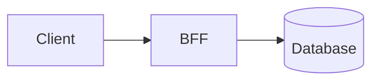

---
# Copy this file into content/blog/personal/ or content/blog/technical/
# and rename it — the file name becomes the URL slug.
# Files starting with "_" are ignored by the build.
title: "Post title"
description: "One or two sentences shown in listings, RSS and search results."
date: 2026-01-01
# updated: 2026-02-01
tags: [Architecture]
featured: false   # featured posts appear first on the home page
draft: true       # drafts are skipped unless you run: npm run content -- --drafts
---

Intro paragraph.

## A section heading

Regular **Markdown** (GitHub-flavoured): tables, lists, `inline code`, links, images.

```typescript
// Fenced code blocks are syntax-highlighted at build time.
const answer = 42;
```


