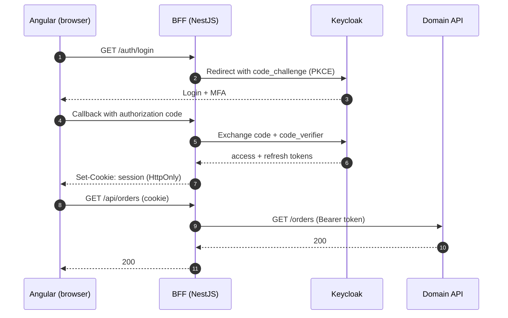

Most Angular applications that integrate with an identity provider end up doing the same thing: run the OIDC flow in the browser, receive an access token, store it somewhere, and attach it to every API call. It works. It is also the part of the system I trust the least.

In enterprise environments — especially government and defence — I now default to a different shape: **the browser never sees a token at all.**

## The problem with tokens in the browser

Wherever you put a bearer token in a single-page application, JavaScript can read it. `localStorage`, `sessionStorage`, an in-memory service — it doesn't matter. Any successful XSS, any compromised dependency, any injected script can exfiltrate it and replay it from anywhere.

Refresh tokens make this worse. A stolen refresh token is not a five-minute problem; it is a session that lives as long as your refresh policy allows.

> A token that JavaScript can read is a token an attacker can read.

The industry guidance has caught up with this. The IETF's *OAuth 2.0 for Browser-Based Applications* draft describes the Backend-for-Frontend as the most secure architecture for browser apps, precisely because it keeps tokens out of the browser.

## The shape of a BFF

A Backend-for-Frontend is a small server-side component that belongs to one front end. For authentication, it does three jobs:

1. Runs the OAuth 2.0 Authorization Code flow **with PKCE** as a confidential client.
2. Stores tokens server-side, keyed by a session.
3. Proxies API calls, attaching the access token on the way out.

The browser holds only an `HttpOnly`, `Secure`, `SameSite` session cookie.



## A minimal NestJS implementation

The login endpoint generates the PKCE pair and state, stores them in the session and redirects to Keycloak:

```typescript
@Get('login')
async login(@Req() req: Request, @Res() res: Response) {
  const verifier = randomBytes(32).toString('base64url');
  const challenge = createHash('sha256').update(verifier).digest('base64url');
  const state = randomBytes(16).toString('base64url');

  req.session.pkce = { verifier, state };

  const url = new URL(`${this.issuer}/protocol/openid-connect/auth`);
  url.search = new URLSearchParams({
    client_id: this.clientId,
    response_type: 'code',
    scope: 'openid profile',
    redirect_uri: this.redirectUri,
    code_challenge: challenge,
    code_challenge_method: 'S256',
    state,
  }).toString();

  res.redirect(url.toString());
}
```

The callback validates `state`, exchanges the code using the stored verifier and the client secret, and saves the tokens **in the session store** — Redis in my case — never in the response body.

The proxy then becomes a thin, boring layer: read the session, refresh the token if it is close to expiry, forward the request with an `Authorization` header.

## What the Angular side looks like

This is the part people like most: the Angular code gets *simpler*.

```typescript
export const authGuard: CanActivateFn = () => {
  const session = inject(SessionService);
  const router = inject(Router);
  return session.me().pipe(map((user) => (user ? true : router.parseUrl('/auth/login'))));
};
```

There is no token interceptor, no silent-refresh iframe and no token storage decision to debate in code review. `HttpClient` calls go to the BFF with `withCredentials` and the cookie does the rest.

## Things to get right

- **CSRF.** Cookies are sent automatically, so protect state-changing requests. `SameSite=Strict` or `Lax` plus a custom header requirement (which a cross-site form cannot set) covers most cases.
- **Session storage.** In a load-balanced deployment the session must live in a shared store. Redis works well and gives you TTLs for free.
- **Logout.** End the Keycloak session too (`end_session_endpoint`), not only the local one.
- **Roles.** Expose a `/me` endpoint that returns the user and their effective permissions. The UI reflects authorization; the APIs enforce it.

## When it is worth it

A BFF is one more component to deploy and operate. For a public marketing site, it is overkill. For enterprise systems that handle sensitive data, integrate with national identity services, or run inside restricted networks, it has consistently been one of the highest-leverage security decisions I've made — and it makes the front end easier to reason about at the same time.
