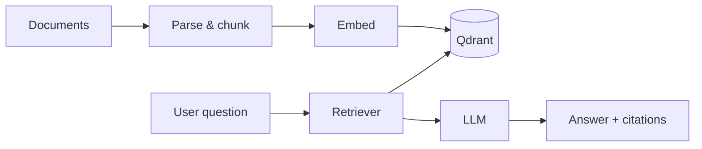

Retrieval-augmented generation is usually demonstrated with three API keys and a notebook. In an enterprise that cannot send a single document outside its network, every one of those keys has to become a service you run yourself.

These are the architecture decisions that mattered most when building document intelligence for a restricted environment.

## Split ingestion from querying

The two halves of a RAG system have completely different performance profiles:

| Path | Workload | Latency budget |
| --- | --- | --- |
| Ingestion | Parse, chunk, embed thousands of pages | Minutes to hours |
| Query | Embed one question, retrieve, generate | A few seconds |

Treat them as separate services. Ingestion runs as background workers fed by a queue; the query path never waits for ingestion work.



## Chunking is a product decision

Chunk size isn't just a tuning parameter — it decides what the system can answer. A few rules that held up well:

- Split on **structure first** (headings, sections, tables), size second.
- Keep a modest overlap so sentences that straddle a boundary aren't lost.
- Store the document title and section path with every chunk; prepend them when embedding. Context-free chunks retrieve poorly.

## Permissions belong in the vector store

The fastest way to lose trust in an internal AI tool is for it to quote a document the user isn't allowed to open. Store access metadata on every point and filter **at query time**, inside the vector search:

```typescript
const results = await qdrant.search('documents', {
  vector: questionEmbedding,
  limit: 8,
  filter: {
    must: [{ key: 'allowed_groups', match: { any: user.groups } }],
  },
  with_payload: true,
});
```

Filtering after retrieval looks equivalent but isn't: you may retrieve eight chunks the user can't see and end up with nothing to answer from.

## Ground the model — and show your work

The prompt contains only retrieved passages, each labelled with a source ID, and an instruction to answer from them or say it doesn't know. The UI shows the cited passages next to the answer.

That last part is not decoration. Users in regulated environments will not act on an answer they can't verify, and citations turn "the AI said so" into "the policy document says so, section 4.2".

## Operate it like any other system

Local models, embedding services and Qdrant are just services: they need health checks, resource limits, versioned deployments and capacity planning. Re-embedding a whole corpus when you change embedding models is a migration — plan it like one.

## What I'd tell a team starting now

Start with retrieval quality, not model size. A smaller local model with excellent retrieval and honest citations beats a larger one guessing from poor context — and it is far easier to run inside a network that has no way out.
